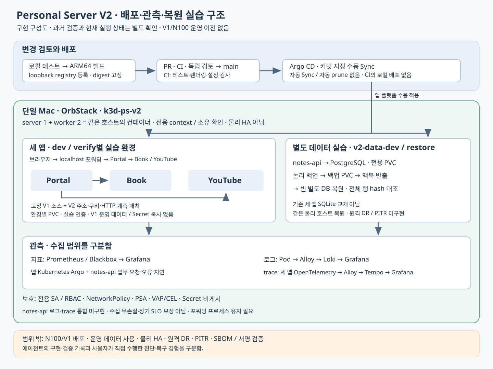

# Personal Server V2 · Kubernetes Platform Lab

V1에서 개발한 Portal·Book·YouTube를 맥북 전용 Kubernetes에 재구성하고, **배포 변경을 검토하고 요청 흐름과 장애 원인을 확인하며 데이터를 복원하는 과정**을 실습하는 프로젝트임. V1 운영 서버를 보존하면서 Argo CD·관측·보안 정책을 별도 환경에서 검증함.

**[면접용 프로젝트 설명](docs/portfolio-devops.md)** · [V1 대비 구축 내용](docs/20261022_V1대비_V2_구축정리.md) · [개발 계획](docs/20261021_V2_개발계획.md)

| 구분 | 구현 내용 | 비고 |
|---|---|---|
| 실행 경계 | macOS·OrbStack·k3d server 1 / worker 2 | 모든 노드가 같은 맥북의 컨테이너이며 물리 HA 아님 |
| 앱·데이터 | V1 고정 소스의 세 앱을 ARM64 이미지로 재빌드, dev/verify별 PVC·실습 인증 사용 | V1 데이터·Secret 복사 없음, 별도 notes-api와 PostgreSQL 추가 |
| 변경 전달 | 로컬 빌드·registry 등록·digest 고정 → PR/CI → main → Argo 수동 Sync | 자동 Sync·자동 prune 미사용, CI는 로컬 클러스터에 배포하지 않음 |
| 관측 | Prometheus·Grafana, Pod 로그 Alloy→Loki, 세 앱 HTTP trace Alloy→Tempo | notes-api는 업무 지표·health/ready 관측, 로그·trace 통합은 미구현 |
| 보호·복원 | RBAC·NetworkPolicy·PSA·VAP/CEL, 별도 PostgreSQL 논리 백업·빈 DB 복원 | 동일 맥북 복원 실습, 원격 DR·PITR 미구현 |

**공부용 자료:** [V2 쉬운 개념과 면접 문답 24개](docs/20261103_V2_쉬운개념과_면접문답.md) · [V1·V2 기준자료와 읽는 순서](https://github.com/Len-Yoon/personal-server/blob/main/docs/20261103_V1V2_학습기준자료.md). 개념의 뜻·선택 이유·실제 코드·흔한 오해를 함께 설명함.

## 검증 기록과 현재 상태

2026-10-26 기능 기준 `a274143`에서 회귀 143개 PASS(skip 0), Argo 18개 Synced/Healthy, 관측 대상 27개 UP, notes-api 대시보드 8패널을 확인한 **과거 로컬 검증 기록**이 있음. 약 183초·12표본의 관측을 장기 가용성이나 부하 성능으로 해석하지 않음. [원본 검증 기록](docs/20261026_V2_관측배포_고도화검증.md)

2026-11-03 문서 갱신 시 읽기 전용 확인에서는 Docker가 실행 중이나 V2 컨테이너 5개는 exited이고 Kubernetes API 연결이 거부됨. 현재 가동 정상으로 표시하지 않으며, 재기동·재배포는 수행하지 않음. 사용자 직접 점검 일부와 에이전트의 구현·검증 기록을 구분하며, 직접 장애 진단·복구 숙련 완료는 확인 필요함.

## 실행·학습 자료

[로컬 실습·접속 가이드](docs/20261021_V2_로컬실습_운영가이드.md) · [직접 학습 계획](docs/20261026_V2_고도화학습계획.md) · [서비스 통합](docs/20261021_V2_서비스통합_검증기록.md) · [GitOps·지표](docs/20261021_V2_GitOps전환_지표관측_검증기록.md) · [로그](docs/20261021_V2_로그수집_검증기록.md) · [요청 추적](docs/20261022_V2_요청추적_검증기록.md) · [보안](docs/20261022_V2_보안강화_검증기록.md) · [백업·복원](docs/20261022_V2_데이터백업복구_검증기록.md) · [작업 기준](AGENTS.md)

시작 시 `python3 tools/lab.py doctor`와 `python3 tools/lab.py status`로 전용 환경과 상태를 먼저 확인함. 실행 절차는 가이드에 따르며, `python3 tools/lab.py serve`는 가동 중인 V2 서비스의 localhost 포워딩을 유지하는 명령임. 주소 접속이나 포워딩만으로 클러스터가 시작되지 않음. 인증값은 Git·로그에 기록하지 않음.

N100 접속·동기화·이미지 반입·운영 배포와 V1 데이터 사용은 V2 범위에서 제외함. 폐쇄망 구축은 보류이며 SBOM·서명 검증·물리 HA·별도 호스트 재해복구는 미구현임.
