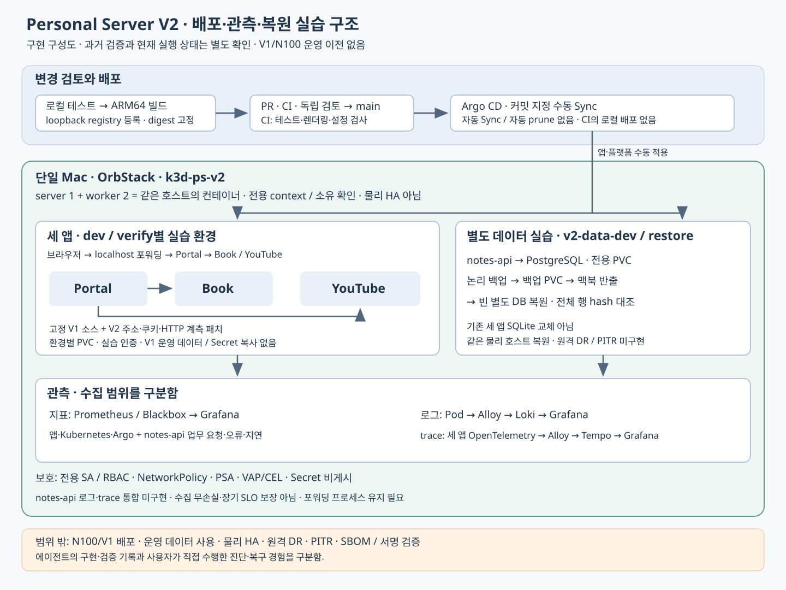

# V2 쉬운 개념과 면접 문답

작성일: 2026-11-03 · 기준 커밋: `73b800da417279bf267d26b2a965ef296d676750`

이 문서는 도구 이름을 외우는 대신 “어떤 문제 때문에 필요했고, 이 프로젝트에서는 어디까지 했는가”를 설명하기 위한 학습 자료다. 면접 답변은 말하기 예시이며, 사용자 본인이 직접 실행하지 않은 검증을 개인 경험으로 바꾸어 말하면 안 된다.

[전체 V1·V2 학습 기준자료](https://github.com/Len-Yoon/personal-server/blob/main/docs/20261103_V1V2_학습기준자료.md) · [V2 면접용 프로젝트 설명](portfolio-devops.md) · [V1 대비 V2 구축 정리](20261022_V1대비_V2_구축정리.md) · [로컬 실행 가이드](20261021_V2_로컬실습_운영가이드.md)

**먼저 구분할 사실**: V2는 맥북의 로컬 실습 플랫폼이다. V1의 Portal·Book·YouTube 고정 소스를 재사용했지만, N100 운영 환경이나 운영 데이터를 옮기지 않았다. V1에도 Kubernetes·CI·관측·백업이 있었으므로 V2가 모든 도구의 최초 도입은 아니다.

2026-10-26 기능 기준 `a274143`의 기록에는 회귀 143개 PASS, Argo Application 18개 Synced/Healthy, 관측 대상 27개 UP이 있다. 이는 당시의 짧은 로컬 검증이다. 2026-11-03 문서의 읽기 전용 현황은 V2 컨테이너 exited·Kubernetes API 연결 거부이며, 이 학습 문서 작성 과정에서는 클러스터를 시작하거나 배포하지 않았다. 현재 가동·장기 가용성·개인의 직접 실습 완료를 뜻하지 않는다. [검증 원본](20261026_V2_관측배포_고도화검증.md), [현황 요약](../README.md)

## 1. Mac·OrbStack·k3d·K3s와 실행 경계

**쉬운 뜻**

Mac은 실제 컴퓨터, OrbStack은 그 안에서 Linux 컨테이너를 실행하는 기반이다. k3d는 컨테이너로 K3s 클러스터를 만드는 도구이고, K3s는 가볍게 구성한 Kubernetes 배포판이다. Kubernetes는 실행할 앱 수와 연결·저장소 같은 원하는 상태를 관리한다.

context는 kubectl이 어느 클러스터에 어떤 사용자·namespace 설정으로 접속할지 고르는 묶음이다. namespace는 한 클러스터 안의 논리적 구분이며, 다른 물리 장비를 만드는 기능은 아니다.

**왜 필요한가**

새 배포 도구와 장애 실습을 운영 서버에서 바로 시험하면 실제 서비스나 데이터에 영향을 줄 수 있다. 전용 로컬 환경과 명시 context는 실수로 잘못된 대상을 조작할 가능성을 줄인다.

**이 프로젝트 연결**

V2는 server 1개·worker 2개를 같은 맥북의 컨테이너로 구성한다. `tools/lab.py`는 전용 kubeconfig·context·소유 표식을 확인한다. Docker가 켜져 있어도 V2 클러스터가 실행 중이라는 뜻은 아니다. [실행 경계 코드](../tools/lab.py)

**흔한 오해**

노드 세 개가 물리 HA를 의미하지 않는다. Mac·컨테이너 엔진·로컬 디스크가 공통 장애점이다. namespace 분리만으로 V1과 물리적으로 분리된다고 말해서도 안 된다.

**Q1. Kubernetes를 왜 맥북에 따로 구성했나요?**

> 운영 V1을 보존하면서 GitOps와 정책, 관측, 복원을 실습하려고 별도 V2를 만들었습니다. 전용 context와 소유 확인으로 작업 대상을 제한하고 운영 데이터는 사용하지 않았습니다.

꼬리질문 판단: “운영과 분리됐나요?”에는 저장소·context·실습 데이터 경계를 설명한다. 다른 호스트의 고가용성까지 확보했다고 답하지 않는다.

**Q2. worker가 두 개면 한 대가 고장 나도 괜찮나요?**

> worker 장애의 상태 변화는 실습할 수 있지만 모든 노드가 같은 맥북에 있습니다. 특히 로컬 볼륨을 쓰는 데이터 앱은 다른 노드로의 이동까지 별도 확인해야 하므로 물리 HA라고 설명하지 않습니다.

꼬리질문 판단: 장애 범위를 Pod·worker·호스트·저장소로 나눠 답할 수 있어야 한다.

## 2. Pod·Deployment·replicas·Service·Endpoint·포워딩

**쉬운 뜻**

Pod는 앱 컨테이너를 실행하는 Kubernetes의 기본 단위다. Deployment는 원하는 Pod 개수와 업데이트를 관리한다. `replicas: 1`은 한 Pod를 유지하라는 선언이며 특정 Pod 하나를 영구 보존한다는 뜻은 아니다.

Service는 바뀔 수 있는 Pod 앞에 안정적인 접근 주소를 제공한다. selector와 준비 상태에 따라 실제 연결 대상이 정해지고, EndpointSlice 등에서 대상 주소를 확인할 수 있다. port-forward는 로컬 포트를 클러스터 안의 대상에 연결하는 임시 통로다.

**왜 필요한가**

Pod 재생성으로 주소가 바뀌어도 호출자가 계속 연결할 수 있어야 한다. 실행 관리와 접근 주소를 분리하면 앱 교체 때마다 호출 주소를 바꾸지 않아도 된다.

**이 프로젝트 연결**

브라우저는 localhost 포워딩으로 Portal에 접근하고, Portal은 같은 환경의 Book·YouTube Service를 호출한다. dev/verify는 각각 별도 앱과 데이터를 쓴다. `serve`는 포워딩을 유지하며 클러스터를 시작하는 명령은 아니다. [앱 명세](../apps/portal/base/deployment.yaml), [서비스 연결 기록](20261021_V2_서비스통합_검증기록.md)

**흔한 오해**

Running은 프로세스 실행 상태이며 요청 처리 준비를 보장하지 않는다. Service가 존재해도 selector 불일치·readiness 실패·통신 정책 때문에 연결되지 않을 수 있다.

**Q3. Service가 있는데 접속이 안 되면 무엇부터 보나요?**

> 먼저 접속 경로와 포워딩을 보고, Service의 selector·포트와 실제 준비된 Endpoint를 확인합니다. 이어 대상 Pod의 readiness·로그·NetworkPolicy를 보면서 어느 구간에서 끊겼는지 좁힙니다.

꼬리질문 판단: “Service를 다시 만들면 되나요?”에는 재생성 전에 빈 Endpoint인지 포트 문제인지 근거를 확인한다고 답한다.

**Q4. Pod를 지우면 앱도 없어지나요?**

> Deployment가 원하는 replicas를 유지하므로 새 Pod를 만들 수 있습니다. 다만 새 Pod가 Ready가 되는지와 데이터가 PVC에 남아 있는지는 별도 확인해야 합니다.

꼬리질문 판단: 새 Pod 생성과 데이터 보존을 구분하고, replicas 증가만으로 SQLite 쓰기 안전성이 해결된다고 말하지 않는다.

## 3. PV·PVC·StatefulSet과 데이터의 수명

**쉬운 뜻**

PV는 클러스터가 제공하는 저장 공간 자원이고 PVC는 앱이 요청하는 저장 공간이다. Pod는 PVC를 마운트해 데이터를 쓴다. Pod가 교체되는 수명과 데이터를 보존하는 수명을 분리하는 것이다.

StatefulSet은 안정적인 Pod 이름과 저장소 연결 등이 필요한 상태 저장 앱에 쓰는 관리 방식이다. StatefulSet만 만들었다고 DB 복제·백업·고가용성이 자동 완성되지는 않는다.

**왜 필요한가**

컨테이너 안의 임시 파일에만 DB를 두면 Pod 교체 후 데이터를 잃을 수 있다. 반대로 PVC가 남아 있어도 데이터 손상이나 호스트 디스크 고장을 막는 것은 아니므로 백업도 필요하다.

**이 프로젝트 연결**

기존 세 앱은 환경별 새 PVC를 사용하고, 별도 PostgreSQL은 StatefulSet과 PVC로 구성한다. notes-api 컨테이너는 Python 3.12 기반이다. Python 버전과 DB 종류·버전은 서로 다른 정보다. [데이터 명세](../platforms/data/dev/resources.yaml), [API 이미지](../apps/notes-api/Dockerfile)

**흔한 오해**

PVC는 백업이 아니다. Pod 삭제·PVC 삭제·PV 회수·호스트 삭제는 결과가 다르며, 삭제 시 보존 여부는 실제 reclaim policy와 provisioner 설정을 확인해야 한다.

**Q5. 앱을 다시 배포해도 데이터가 남는 이유는 무엇인가요?**

> 앱 Pod와 저장소 수명을 분리해 PVC를 마운트했기 때문입니다. 배포 뒤 새 Pod의 정상화와 기존 샘플 데이터가 그대로 조회되는지를 함께 확인하는 방식입니다.

꼬리질문 판단: “PVC만 있으면 안전한가요?”에는 논리 손상·오삭제·호스트 장애를 대비한 백업은 별도라고 답한다.

**Q6. PostgreSQL에 Deployment 대신 StatefulSet을 쓴 이유는요?**

> DB처럼 안정적인 실행 식별자와 저장소 연결을 관리할 상태 저장 워크로드이기 때문입니다. 다만 이 구성은 로컬 단일 DB 실습이며 복제나 자동 failover를 구현한 구조는 아닙니다.

꼬리질문 판단: StatefulSet 선택 이유와 PostgreSQL 자체의 데이터 복제 기능을 구분한다.

## 4. 선언형 설정·Kustomize·Helm

**쉬운 뜻**

명령형이 “지금 Pod를 하나 더 만들어라”라면 선언형은 “Pod가 하나 있어야 한다”는 원하는 상태를 적는 방식이다. 컨트롤러가 실제 상태를 그 선언에 맞추려 한다.

Kustomize는 공통 YAML에 환경별 차이를 겹쳐 최종 명세를 만든다. Helm은 chart의 템플릿에 values를 넣어 Kubernetes 명세를 생성하고 패키지 단위로 다룬다.

**왜 필요한가**

설정을 기억이나 수동 명령에만 맡기면 환경 차이를 재현하고 검토하기 어렵다. 공통 구조와 환경 차이를 코드로 남기면 변경 전후 비교와 재현이 쉬워진다.

**이 프로젝트 연결**

앱은 Kustomize base/overlay로 관리하고 Argo·관측 플랫폼에는 Helm chart와 values를 사용한다. CI는 렌더링 결과와 계약을 검사한다. 렌더링 성공은 실제 API 적용·스케줄링·요청 성공과 다른 단계다. [Book base](../apps/book/base/deployment.yaml), [Argo values](../platforms/argocd/values.yaml), [CI](../.github/workflows/validate.yml)

**흔한 오해**

YAML이 있다고 모두 GitOps인 것은 아니다. 어떤 Git 상태를 누가 실제 환경과 비교·반영하는지가 연결돼야 한다. 템플릿 도구가 보안 정책이나 데이터 호환성을 자동 보장하지도 않는다.

**Q7. Kustomize와 Helm을 왜 같이 사용했나요?**

> 직접 관리하는 앱의 환경 차이는 overlay로 표현하고, 플랫폼 구성은 chart와 values로 관리했습니다. 최종적으로 둘 다 Kubernetes 명세를 만들며, Argo가 Git의 명세와 실제 상태를 연결합니다.

꼬리질문 판단: 두 도구의 우열보다 관리 대상과 변경 형태에 맞춘 선택을 설명한다.

**Q8. YAML 렌더링이 통과하면 배포 성공인가요?**

> 아닙니다. 생성된 명세를 검사한 단계입니다. 적용 권한과 admission, 이미지 pull, readiness, 실제 요청과 데이터 보존까지 확인해야 배포 결과를 판단할 수 있습니다.

꼬리질문 판단: 정적 검증·서버 적용·rollout·업무 동작을 순서대로 구분한다.

## 5. GitOps·Argo CD·Application·AppProject·root/self

**쉬운 뜻**

GitOps는 검토된 Git의 선언을 기준으로 실제 환경을 관리하는 방식이다. Argo CD는 Git에서 명세를 읽고 클러스터 상태와 비교하며 Sync로 반영한다.

Application은 “어느 저장소의 어느 경로·revision을 어느 환경에 적용할지” 정의한다. AppProject는 그 Application이 쓸 저장소·대상 namespace·자원 종류를 제한한다.

**왜 필요한가**

수동 변경만 누적되면 환경이 왜 현재 모습인지 설명하기 어렵다. Git 이력과 실제 상태를 연결하면 변경 이유·검토·적용 대상을 추적하기 쉽다.

**이 프로젝트 연결**

root는 하위 플랫폼·앱 Application 등의 구성을 묶고 self는 Argo 자체 chart를 관리한다. 최초 기동과 Argo 장애 복구에는 별도 경로가 필요하며, self 관리가 모든 장애에서 자동 복구됨을 의미하지 않는다. [root 구성](../platforms/gitops/root/kustomization.yaml), [self 구성](../platforms/argocd/self.yaml), [Application/AppProject](../platforms/argocd/applications.yaml)

**흔한 오해**

Argo CD는 CI 테스트 실행기의 대체가 아니다. AppProject 제한도 Kubernetes 관리자나 Mac 호스트 권한까지 막는 독립 보안 경계는 아니다.

**Q9. GitOps를 도입해서 무엇이 달라졌나요?**

> 적용할 선언과 변경 이력을 Git에 남기고 Argo에서 실제 상태 차이를 확인하도록 연결했습니다. V2에서는 수동 Sync를 선택해 적용할 커밋과 관찰 시점을 직접 통제합니다.

꼬리질문 판단: “Git에 넣으면 자동 배포인가요?”에는 자동 여부는 Sync 정책에 달려 있으며 이 프로젝트는 수동이라고 답한다.

**Q10. Argo 자체도 Argo로 관리하면 장애 때 어떻게 하나요?**

> 정상 변경은 Git 기준으로 진행하고, Argo가 멈추면 같은 검토 명세의 고정 chart·values로 최소 복구하는 비상 경로를 둡니다. 기존 클러스터의 controller 복구 기록과 빈 환경 전체 재설치는 구분합니다.

꼬리질문 판단: 비상 복구의 강제 적용 위험을 알고 정상 배포 경로와 구분해야 한다. [실행 기록](20261021_V2_GitOps전환_지표관측_검증기록.md)

## 6. CI·이미지·registry·tag·digest와 수동 CD

**쉬운 뜻**

CI는 변경을 합치기 전후에 테스트와 설정 검사를 반복하는 절차다. 이미지는 실행할 앱과 의존성을 묶은 산출물이고 registry는 그 이미지를 저장·배포하는 곳이다.

tag는 사람이 붙이는 이름으로 같은 이름의 내용이 바뀔 수 있다. digest는 이미지 manifest의 내용에 대응하는 해시 식별자다. Git SHA는 소스 커밋 식별자이며 이미지 digest와 역할이 다르다.

**왜 필요한가**

“코드가 검사됐다”, “실행 이미지가 만들어졌다”, “그 이미지가 환경에 반영됐다”를 각각 확인해야 엉뚱한 버전 배포를 찾아낼 수 있다.

**이 프로젝트 연결**

맥북에서 테스트→ARM64 이미지 빌드→loopback registry 등록→실제 digest·아키텍처 확인→명세 갱신을 한다. PR·CI·main 반영 뒤 정확한 Git SHA로 Argo 수동 Sync한다. CI Python은 3.12로 고정했으며 CI가 로컬 이미지를 빌드하거나 맥북 클러스터에 배포하지 않는다. [배포 준비](../tools/prepare_data_release.py), [이미지 잠금](../apps/images.lock.json), [CI 원본](../.github/workflows/validate.yml)

**흔한 오해**

CI 초록색은 배포 증거가 아니다. digest 고정은 변경되지 않은 내용을 지정하지만 제작자 신뢰·취약점 부재·서명 검증까지 증명하지 않는다.

**Q11. 코드 수정부터 서비스 반영까지 설명해 주세요.**

> 로컬 검증 후 ARM64 이미지를 registry에 등록하고 digest와 명세를 갱신합니다. PR·CI·검토·병합을 거친 정확한 커밋을 Argo로 수동 적용하고 rollout과 요청·데이터 보존을 확인합니다.

꼬리질문 판단: 준비 도구가 commit·push·PR·병합·배포까지 자동 수행한다고 확대하지 않는다.

**Q12. latest 대신 digest를 고정한 이유는요?**

> 같은 이름이 다른 이미지를 가리키는 일을 피하고 검토한 이미지 내용을 배포 명세에서 식별하려고 고정했습니다. 다만 누가 만들었는지 확인하는 서명이나 SBOM은 별도이며 아직 구현하지 않았습니다.

꼬리질문 판단: ARM64 일치·Git SHA·이미지 digest·서명의 의미를 섞지 않는다.

## 7. Synced·Healthy·readiness·drift·Git revert

**쉬운 뜻**

Synced는 비교 기준의 Git 선언과 실제 자원이 맞는지에 대한 상태다. Healthy는 자원 종류별 상태 평가다. readiness는 Pod가 요청을 받을 준비가 됐는지를 판단하는 신호다.

drift는 선언과 실제 상태가 달라진 것이다. Git revert는 과거 변경을 되돌리는 새 커밋을 남긴다. 과거 커밋을 덮어쓰는 방식과 구분한다.

**왜 필요한가**

명세 적용이 성공해도 이미지가 없거나 DB 접속이 실패하면 앱은 사용할 수 없다. 되돌리기도 이미지·허용 정책·명세가 함께 맞아야 하며 데이터 호환성을 별도로 고려해야 한다.

**이 프로젝트 연결**

자동 Sync·자동 prune·selfHeal을 사용하지 않는다. sync 도구는 정확한 SHA와 요청 표식을 확인한 뒤 rollout도 기다린다. Application의 비교 기준은 `main`이므로 main이 진행하면 지정 SHA 적용 결과와 현재 비교 revision이 달라질 수 있다. 작업 성공·적용 SHA·비교 revision·Healthy를 따로 본다. [sync 구현](../tools/lab.py), [GitOps 실습 기록](20261021_V2_검증기록.md)

**흔한 오해**

Synced/Healthy만으로 모든 업무 기능 정상이나 데이터 보존을 증명하지 않는다. prune 미사용은 삭제 위험을 줄이는 선택이지만 불필요한 자원 정리가 자동 완료된다는 뜻은 아니다.

**Q13. manifest 적용 성공인데 배포 실패일 수 있나요?**

> 가능합니다. 기록에서는 잘못된 이미지 커밋 적용 후 ImagePullBackOff와 rollout 실패를 확인했습니다. 이후 실제 revert 커밋을 Sync해 정상화와 샘플 보존을 확인했고, 이는 에이전트 실행 증거로 구분합니다.

꼬리질문 판단: 실패 배포를 main의 운영 장애로 설명하지 않는다. 별도 실습 브랜치 사례다.

**Q14. 왜 자동 selfHeal을 끄고 수동으로 원복했나요?**

> 의도한 drift가 바로 사라지면 학습자가 차이를 관찰하기 어렵기 때문입니다. replicas 변경과 OutOfSync를 확인한 뒤 같은 커밋으로 다시 동기화하는 실습을 선택했습니다.

꼬리질문 판단: 앱 원복에 PVC 삭제·DB 복원을 포함하지 않는다. Git revert 직접 수행 여부는 별도 근거로 답한다.

## 8. 지표·counter·gauge·histogram·p95

**쉬운 뜻**

지표는 시간에 따라 상태를 숫자로 관측하는 자료다. counter는 요청 누적 횟수처럼 증가하며 프로세스 재시작 때 초기화될 수 있다. gauge는 메모리 사용량처럼 오르내릴 수 있는 현재값이다.

histogram은 요청 시간을 구간별 누적 개수와 합계로 기록한다. p95는 관측 분포에서 약 95%의 요청이 그 이하였다는 지연값이며 평균과 다르다. histogram 기반 값은 bucket과 표본에 따른 추정이다.

**왜 필요한가**

“느리다”를 요청량·오류율·지연·자원 상태로 나누면 어떤 현상이 언제 발생했는지 좁힐 수 있다. 평균만 보면 일부 매우 느린 요청을 놓칠 수 있다.

**이 프로젝트 연결**

Prometheus는 지표를 수집·질의하고 Blackbox는 HTTP 등 외부 관점의 probe를 수행한다. Grafana는 이를 화면에 보여준다. notes-api는 업무 요청·4xx·5xx·지연을 제공하며 health/ready와 업무 요청을 구분한다. [API 지표 코드](../apps/notes-api/app.py), [Prometheus 설정](../platforms/observability/prometheus/values.yaml), [대시보드](../platforms/observability/grafana/chart/files/v2-notes-api.json)

**흔한 오해**

Prometheus target UP은 수집 성공이지 모든 업무 정상이라는 뜻이 아니다. 짧고 적은 표본의 p95나 오류 0회를 장기 SLA·수용 가능한 최대 부하로 표현하지 않는다.

**Q15. counter에서 오류율을 어떻게 보나요?**

> 누적 숫자 자체보다 같은 시간 범위의 증가율을 비교합니다. 서버 오류 counter의 rate를 업무 요청 counter의 rate로 나누고, 요청량과 관측 시간도 함께 봅니다.

꼬리질문 판단: 재시작으로 counter가 초기화될 수 있다는 점과 4xx·5xx의 분모·정의를 설명한다.

**Q16. health가 200인데 사용자는 실패할 수 있나요?**

> 단순 health는 프로세스 생존만 확인할 수 있습니다. notes-api의 ready는 DB 테이블 조회를 확인하지만 그것도 모든 CRUD를 보장하지 않으므로 업무 요청 지표와 실제 동작을 함께 확인해야 합니다.

꼬리질문 판단: blackbox 성공·readiness·실제 인증 CRUD 각각이 확인하는 범위를 구분한다.

## 9. 로그·Alloy·Loki와 trace·OpenTelemetry·Tempo

**쉬운 뜻**

로그는 특정 시점의 사건 기록이다. trace는 요청이 여러 구간을 거친 흐름이고 span은 그 안의 작업 한 구간이다. context 전파는 다음 서비스에 trace 식별 정보와 부모 관계를 넘기는 과정이다.

OpenTelemetry는 계측과 전달을 위한 표준·도구를 제공한다. OTLP는 관측 데이터를 전달하는 프로토콜이다. Alloy는 수집·전달을 맡고 Loki는 로그, Tempo는 trace를 저장·조회하는 역할을 한다.

**왜 필요한가**

지표로 이상을 발견한 뒤 로그로 구체적인 사건을 보고 trace로 어느 호출 구간이 느리거나 실패했는지 좁힐 수 있다. 각 자료는 서로 보완하며 하나만으로 전체 원인을 확정하기 어렵다.

**이 프로젝트 연결**

세 앱 Pod stdout/stderr는 Alloy→Loki로, 세 앱 HTTP trace는 OpenTelemetry→Alloy OTLP→Tempo로 전달한다. Portal→Book/YouTube의 부모·자식 span과 같은 요청 로그의 trace ID를 연결한다. notes-api는 현재 업무 지표·health/ready 범위이며 로그·trace 통합은 미구현이다. [계측 코드](../tools/telemetry/v2_telemetry.py), [로그 기록](20261021_V2_로그수집_검증기록.md), [추적 기록](20261022_V2_요청추적_검증기록.md)

**흔한 오해**

수집기가 있다고 모든 로그·trace를 빠짐없이 수집하는 것은 아니다. trace ID가 같다는 사실에 더해 부모·자식 관계와 구간 시간을 확인해야 요청 흐름을 설명할 수 있다.

**Q17. 통합 검색이 느리면 세 도구를 어떻게 쓰나요?**

> 지표에서 오류와 지연이 늘어난 시점을 찾고 해당 요청 trace에서 Portal과 하위 검색 호출 시간을 나눠 봅니다. 같은 trace ID의 로그로 오류 내용을 대조하며 원인을 좁힙니다.

꼬리질문 판단: 관측 결과를 곧바로 원인으로 단정하지 않고 DB·네트워크·하위 API 가설을 구분한다.

**Q18. notes-api까지 분산 추적을 구현했나요?**

> 아직 아닙니다. 세 앱의 HTTP 요청 추적과 로그 연계를 구현했고 notes-api에는 업무 지표와 health/ready 관측을 연결했습니다. notes-api 로그·trace 연계는 후속 범위로 남아 있습니다.

꼬리질문 판단: `/metrics`가 있다고 자동으로 로그·trace까지 계측된다고 답하지 않는다.

## 10. SA·RBAC·NetworkPolicy·PSA·VAP/CEL·Secret

**쉬운 뜻**

ServiceAccount는 Pod 등에서 사용하는 Kubernetes 신원이고 RBAC은 그 신원이 API에 어떤 동작을 할 수 있는지 정한다. NetworkPolicy는 선택된 Pod의 통신을 제한한다.

PSA는 Pod 보안 기준을 namespace 수준에서 적용한다. VAP는 ValidatingAdmissionPolicy이며 CEL 조건으로 들어오는 자원 명세를 검사한다. Secret의 base64 표현은 암호화가 아니며 접근 권한·저장 암호화·취급 방식을 별도로 관리해야 한다.

**왜 필요한가**

앱이 침해되거나 설정을 잘못 작성했을 때 모든 API·통신·권한을 쓸 수 없도록 권한을 줄인다. 하나의 계층이 놓친 위험을 다른 계층에서 제한하는 방식이다.

**이 프로젝트 연결**

전용 SA·RBAC, 토큰 자동 마운트 차단, default deny 기반 필요한 통신만 허용, PSA·VAP/CEL을 적용한다. 실습 인증값은 Git·로그에서 제외한다. NetworkPolicy는 허용 규칙·DNS·실제 네트워크 구현을 함께 봐야 한다. [접근 정책](../platforms/security/access/access.yaml), [admission 정책](../platforms/security/policies/admission.yaml), [보안 검증](20261022_V2_보안강화_검증기록.md)

**흔한 오해**

RBAC은 Pod 네트워크 방화벽이 아니다. NetworkPolicy도 모든 호스트 통신·클러스터 관리자 권한을 막지 않는다. API 권한·패킷 통신·명세 검사·호스트 신뢰 경계를 구분한다.

**Q19. 보안을 여러 계층으로 나눈 이유는 무엇인가요?**

> 작업 대상은 context와 소유 확인, API 권한은 SA·RBAC, 통신은 NetworkPolicy, 배포 명세는 PSA·VAP/CEL로 나눠 제한했습니다. 각 계층의 허용과 거부를 별도 검사해 경계를 확인했습니다.

꼬리질문 판단: 테스트 통과를 전체 보안 보증으로 확대하지 않고 관리자·호스트 권한은 신뢰 경계로 남는다고 답한다.

**Q20. Secret과 digest가 있으면 안전한 배포인가요?**

> Secret은 비밀 데이터를 별도 자원으로 취급하지만 base64 자체는 암호화가 아닙니다. digest는 이미지 내용을 고정하는 식별자이며 제작자 인증이나 취약점 검증을 대신하지 않으므로 다른 통제가 필요합니다.

꼬리질문 판단: 실제 비밀값이나 인증 파일 내용을 보여주지 않고 권한·저장·전송·로그 노출 통제를 설명한다.

## 11. PostgreSQL·SQLite·DDL/DML·migration·백업 복원

**쉬운 뜻**

SQLite는 앱이 DB 파일을 직접 이용하는 내장형 DB이고 PostgreSQL은 별도 서버에 접속하는 DB다. 우열보다 쓰기 동시성·운영 복잡도·접속 모델·복원 요구를 보고 선택한다.

DDL은 테이블 같은 구조를 정의하는 작업이고 DML은 행을 조회·추가·수정·삭제하는 작업이다. migration은 스키마 변경을 버전과 실행 순서에 맞춰 관리하는 절차다. RTO는 복구 시간 목표, RPO는 허용 가능한 데이터 손실 시점·시간 목표다.

**왜 필요한가**

앱이 돌아온 것과 데이터가 올바르게 돌아온 것은 다르다. 백업 생성뿐 아니라 무결성·복원 대상·데이터 일치·복원 후 쓰기까지 확인해야 복구 가능성을 논할 수 있다.

**이 프로젝트 연결**

별도 notes-api가 PostgreSQL을 사용하며 기존 세 앱 SQLite를 전환하지 않았다. API 실행과 DDL migration을 분리하고 소유자 계정으로 초기화한 뒤 앱에는 DML 권한을 준다. 논리 백업을 빈 별도 DB에 복원해 데이터와 API를 확인한다. [API와 migration](../apps/notes-api/app.py), [백업 코드](../tools/data_backup/backup.py), [복원 검증](20261022_V2_데이터백업복구_검증기록.md)

**흔한 오해**

로컬 백업 PVC와 맥북 반출 파일은 같은 호스트 장애에 함께 영향을 받을 수 있다. 작은 데이터의 빈 DB 준비 후 복원 시간은 환경 전체 RTO가 아니며 시간당 CronJob 설정만으로 RPO가 보장되지 않는다. 원격 DR·PITR은 미구현이다.

**Q21. DB 접속 실패가 나면 계속 재시도하면 되나요?**

> 실패 종류를 먼저 구분해야 합니다. 실제 기록에서는 새 Job의 최초 DB 접속 실패를 SELECT 1 준비 확인의 제한 재시도로 넘겼지만, 백업·복원 쓰기 자체를 무조건 재시도하지 않았습니다.

꼬리질문 판단: 읽기 준비 확인과 상태 변경 작업의 중복 실행 위험을 구분한다. 같은 기록의 권한 오류는 설정 보완 후 검증한 사례이며 일시 장애로 취급하지 않는다.

**Q22. 복원이 성공했다고 무엇을 확인했나요?**

> 별도의 빈 DB에 복원하고 전체 행 hash와 API 조회·변경을 확인한 기록이 있습니다. 원본 데이터 보존과 재복원 거부도 확인했지만 같은 맥북의 소량 합성 데이터 실습이라 원격 DR 실적으로 설명하지 않습니다.

꼬리질문 판단: 백업 이후 데이터가 빠지는 복구 지점과 복원 소요 시간의 시작·종료 범위를 설명한다. 스키마 비호환을 일반 앱 rollback으로 해결했다고 말하지 않는다.

## 12. Pending·OOM·ImagePull·CrashLoop와 진단 순서

**쉬운 뜻**

Pending은 Pod가 아직 실행을 시작하지 못한 상태로 스케줄링·볼륨·이미지 준비 등을 확인해야 한다. ImagePullBackOff는 이미지 가져오기에 실패해 재시도를 늦추는 상태다. CrashLoopBackOff는 반복 종료한 컨테이너의 재시작을 늦추는 상태다.

OOMKilled는 메모리 부족으로 종료됐다는 단서다. requests는 주로 스케줄링에 쓰이는 자원 요구량이고 limits는 실행 중 제한이다. CPU limit은 throttling, 메모리 limit 초과는 OOM 종료로 이어질 수 있으며 실제 종료 이유를 확인해야 한다.

**왜 필요한가**

같이 “앱이 안 뜬다”로 보여도 잘못된 이미지 주소, 자원 부족, PVC 문제, 앱 설정 오류는 조치가 다르다. 재시작부터 반복하면 원인을 잃거나 데이터를 위험하게 만들 수 있다.

**이 프로젝트 연결**

이미지 누락·Pending·OOM·probe·worker 장애 실습과 안전 경계가 있다. 진단은 전용 환경 확인→상태·이벤트→로그·이전 로그→명세·지표→최소 조치→정상 요청·데이터 확인 순서로 연습한다. 명령 실행 전 현재 가동과 승인 범위를 먼저 확인한다. [장애 도구](../tools/lab.py), [직접 학습 계획](20261026_V2_고도화학습계획.md)

**흔한 오해**

BackOff는 근본 원인 이름이 아니다. OOM도 “메모리만 올리면 끝”으로 단정하지 말고 사용량·limit·누수·부하를 본다. readiness 실패와 liveness에 의한 재시작도 구분한다.

**Q23. 장애를 진단하는 과정을 설명해 주세요.**

> 먼저 영향 범위와 환경을 확인하고 상태·이벤트·로그로 가설을 세웁니다. 예를 들어 Endpoint가 없으면 readiness와 selector를 대조합니다. 근거에 맞는 최소 조치를 한 뒤 요청과 데이터 보존까지 다시 확인합니다.

꼬리질문 판단: “재시작했더니 됐다”에서 멈추지 말고 무엇을 관측했고 어떤 가설이 지지·기각됐는지 말한다.

**Q24. 자동 검증이 많으면 직접 장애 대응도 익숙한가요?**

> 자동 검증은 구현된 계약과 실행 결과의 증거입니다. 제가 직접 상태를 읽고 가설·조치·복구 확인을 반복한 숙련과는 다릅니다. 면접에서는 에이전트의 검증 기록과 제가 직접 수행한 범위를 분리해 말하겠습니다.

꼬리질문 판단: 직접 하지 않은 장애를 개인 경험으로 말하지 않는다. 직접 실습 후에는 명령·출력 해석·판단·보존 결과를 자신의 기록으로 남긴다.

## 학습 순서와 자기 점검

1. 먼저 1~3장에서 “어디에서 무엇이 실행되고 데이터는 어디 남는가”를 그림 없이 설명한다.
2. 4~7장에서 코드 검사→이미지 준비→Git 검토→수동 배포→요청 확인의 경계를 설명한다.
3. 8~10장에서 이상을 찾는 관측 자료와 허용·거부를 정하는 보안 계층을 연결한다.
4. 11~12장에서 백업·복원과 장애 진단을 공부한다. 실제 실행은 [직접 학습 계획](20261026_V2_고도화학습계획.md)의 첫 미완료 과제와 현재 환경 확인부터 진행한다.

자기 점검: “지금 안다” 대신 아래를 직접 말해 본다.

- 이 상태가 확인한 사실과 아직 확인하지 못한 것은 무엇인가?
- 실패를 뒷받침하는 이벤트·로그·지표가 있고 다른 가설과 구분했는가?
- 조치 전 대상·데이터 경계가 맞으며 조치 후 요청과 데이터가 보존됐는가?
- 설명 중 구현·과거 검증·현재 상태·내 직접 경험을 섞지 않았는가?

이 문서는 학습용 해설과 24개 문답을 추가한 자료다. 코드·CI·배포 명세·과거 검증 기록을 변경하지 않았으며 새 운영 검증이나 클러스터 실행 결과를 만들지 않았다.
