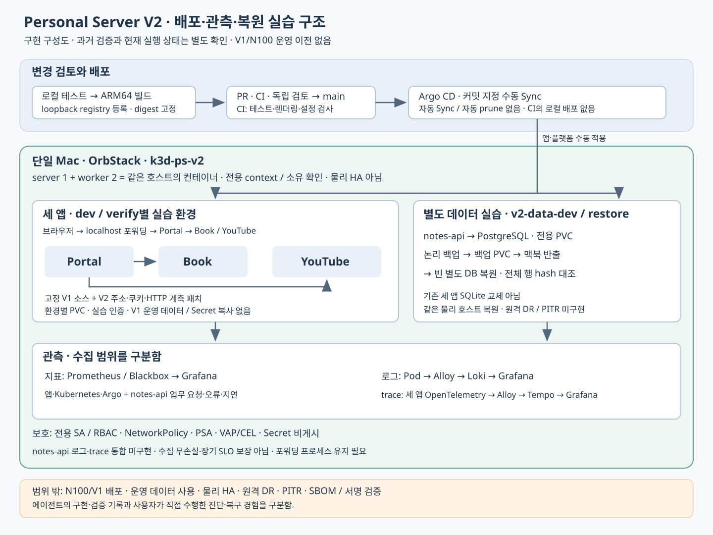

# V2 개념과 면접 문답

작성일: 2026-11-04 · 저장소 기준: `46701f095f7f543b255586f2c1eaf454ddd12c2f`

처음에는 **“어디에서 실행하는가 → 어떻게 연결하는가 → 어떻게 바꾸고 확인하는가”** 세 가지만 생각하면 된다. 각 장의 한 줄 핵심을 먼저 읽고, 설명을 이해한 다음 답변 예시를 자기 말로 바꿔 본다. 용어를 한꺼번에 암기할 필요는 없다.

기본 질문은 **12개**다. 각 장의 선택 꼬리질문 **12개**는 기본 내용을 설명할 수 있을 때 읽는다. 이해 확인은 시험 문제가 아니라, 헷갈린 부분을 찾는 짧은 점검이다.

[전체 학습 안내](https://github.com/Len-Yoon/personal-server/blob/main/docs/20261104_V1V2_학습안내.md) · [프로젝트 설명](portfolio-devops.md) · [V1 대비 구축 내용](20261022_V1대비_V2_구축정리.md) · [직접 학습 계획](20261026_V2_고도화학습계획.md)

## 읽기 전에: 이번 정리에서 달라진 것

설명을 짧은 단계로 바꾸고 기본 질문을 줄였다. 저장소 기준은 위 커밋이며, 이번 학습자료 정리에서 V2의 새로운 기능을 추가한 것은 아니다. V1의 최근 PR #482·#483 변경을 V2에도 적용했다고 해석하면 안 된다. V2는 고정한 V1 앱 소스와 V2 전용 구성을 사용하는 별도 저장소다.

상태도 날짜를 붙여 읽는다. 2026-10-26 기록의 회귀 143개 PASS·Argo Application 18개 Synced/Healthy·관측 대상 27개 UP은 **당시의 로컬 검증**이다. 2026-11-03 읽기 전용 관측에서는 V2 컨테이너가 exited였고 Kubernetes API 연결이 거부됐다. **2026-11-04 새 가동 조회와 클러스터 기동은 수행하지 않았다.** 과거 수치를 현재 정상 상태로 설명하지 않는다. [과거 검증 원본](20261026_V2_관측배포_고도화검증.md), [상태 설명](../README.md)

또한 세 가지 근거를 구분한다. 코드에서 확인한 것은 “구현”, 실행 기록에서 확인한 것은 “그때 검증”, 본인이 직접 실행하고 해석한 것은 “직접 경험”이다. 아래 답변은 이해를 돕는 예시이며 에이전트의 실행 기록을 개인의 직접 경험으로 바꾸어 말하지 않는다.

## 1. V2는 어디에서 실행하나요?

**한 줄 핵심**: V2는 운영 서버를 건드리지 않고 맥북에서 실습하기 위한 별도 환경이다.

**짧은 쉬운 설명**

Kubernetes는 앱이 원하는 개수로 실행되도록 관리하고 연결·저장소 설정을 다루는 플랫폼이다. V2에서는 Mac 안의 OrbStack이 Linux 컨테이너 실행 기반을 제공하고, k3d가 컨테이너로 K3s 클러스터를 구성한다. K3s는 Kubernetes 배포판의 하나다.

노드는 앱을 실행하는 자리가 된다. V2의 server 1개·worker 2개는 모두 같은 맥북 안의 컨테이너다. 따라서 맥북이 멈추면 함께 영향을 받는다. 전용 context는 명령이 접속할 클러스터와 사용자 설정을 고르는 이름이라고 이해하면 된다.

**이 프로젝트 예시**

V1은 보존하고 V2만 대상으로 확인한다. `tools/lab.py`는 전용 kubeconfig·context·소유 표식을 확인하도록 구현돼 있다. Docker 실행과 V2 클러스터 실행은 다른 상태다. [실행 경계 코드](../tools/lab.py)

**질문 1. 왜 별도의 V2를 만들었나요?**

**답변 예시**

> 운영 중인 V1에 바로 장애 실습을 하기 어려워서 맥북에 별도 환경을 만들었습니다. V1의 일부 앱 소스를 재사용하지만 운영 데이터와 인증값은 가져오지 않고, 배포와 관측·복원을 실습하는 용도입니다.

**이해 확인**: “노드 세 개 = 물리 장비 세 대”일까? 아니다. V2에서는 같은 맥북에 있으므로 물리적인 고가용성, 즉 한 장비가 고장 나도 계속 서비스하는 구조를 확보한 것은 아니다.

선택 꼬리질문 1: namespace를 나누면 물리적으로도 분리될까? namespace는 한 클러스터 안의 논리적 구분이다. 별도 호스트나 독립 디스크를 만들지 않는다.

## 2. 앱은 어떻게 실행하고 연결하나요?

**한 줄 핵심**: Pod가 앱을 실행하고, Deployment가 실행 개수를 관리하며, Service가 접근 주소를 제공한다.

**짧은 쉬운 설명**

Pod는 앱 컨테이너를 실행하는 기본 단위다. Deployment에 `replicas: 1`이라고 쓰면 Pod 하나를 유지하려 한다. Pod 하나가 사라졌을 때 새 Pod를 만드는 방식이지, 기존 Pod 자체를 영구 보존하는 방식은 아니다.

Pod 주소가 바뀌어도 호출자가 접근할 주소가 필요하다. Service가 그 역할을 한다. 실제 연결 대상 주소는 EndpointSlice 등에서 확인한다. port-forward는 내 맥북의 포트를 클러스터 안의 대상에 이어 주는 임시 통로다.

**이 프로젝트 예시**

브라우저→localhost 포워딩→Portal로 접근하고, Portal이 같은 환경의 Book·YouTube Service를 호출한다. `serve` 명령은 이 포워딩을 유지하며, 멈춘 클러스터를 시작하는 명령은 아니다. [서비스 통합 기록](20261021_V2_서비스통합_검증기록.md), [Portal 명세](../apps/portal/base/deployment.yaml)

**질문 2. Service가 있는데도 접속이 안 되면 어떻게 보나요?**

**답변 예시**

> 먼저 포워딩과 접속 주소를 확인합니다. 그다음 Service가 어떤 Pod를 선택하는지, 연결할 준비가 된 대상 주소가 있는지 봅니다. 대상이 없다면 Pod 준비 상태와 설정부터 확인하겠습니다.

**이해 확인**: “Service가 있다”와 “뒤의 Pod가 정상 요청을 받는다”는 같은 말일까? 아니다. 선택 조건·포트·준비 상태·통신 정책을 더 봐야 한다.

선택 꼬리질문 2: Running이면 준비가 끝난 걸까? readiness는 요청을 받을 준비가 됐는지 확인한다. Pod 실행 중이어도 DB 접속 실패 등으로 준비되지 않을 수 있다.

## 3. Pod가 바뀌어도 데이터는 어떻게 남기나요?

**한 줄 핵심**: 앱 실행 공간과 데이터를 보관하는 공간의 수명을 분리한다.

**짧은 쉬운 설명**

PV는 Kubernetes가 제공하는 저장 공간 자원이고, PVC는 앱이 그 공간을 요청하는 자원이다. 앱은 PVC를 연결해 사용한다. 컨테이너의 임시 공간에만 파일을 쓰는 것과 구분한다.

StatefulSet은 DB처럼 안정적인 이름과 저장소 연결이 필요한 앱을 관리하는 방식이다. 이것만으로 DB 복제나 백업이 자동 구성되지는 않는다. 로컬 저장소는 호스트나 노드 장애 때 이동·복구에 제약이 있을 수 있다.

**이 프로젝트 예시**

기존 세 앱은 환경별 새 PVC를 사용하고, 별도 PostgreSQL DB는 StatefulSet과 PVC로 구성한다. V1 운영 DB를 복사한 구성이 아니다. [데이터 명세](../platforms/data/dev/resources.yaml)

**질문 3. 앱을 다시 배포해도 데이터가 남는 이유는 무엇인가요?**

**답변 예시**

> 앱 Pod와 저장소를 따로 관리하고 새 Pod도 PVC를 연결하도록 구성했기 때문입니다. 다만 설정만 보고 보존됐다고 말하지 않고, 배포 뒤 기존 샘플 데이터가 다시 조회되는지도 확인해야 합니다.

**이해 확인**: PVC가 있으면 백업은 필요 없을까? 아니다. 오삭제·데이터 손상·디스크 고장에 대비한 별도 사본과 복원 확인이 필요하다.

선택 꼬리질문 3: Pod 삭제와 PVC 삭제는 같은가? 다르다. PVC를 삭제했을 때 실제 데이터가 남는지는 저장소의 회수 정책과 제공 방식까지 확인해야 한다.

## 4. 설정을 왜 파일로 관리하나요?

**한 줄 핵심**: 원하는 상태를 파일에 적어 두면 변경을 비교하고 같은 구성을 다시 만들기 쉽다.

**짧은 쉬운 설명**

“지금 하나 실행해”라는 명령 대신 “항상 하나가 있어야 한다”라고 적는 것이 선언형 설정이다. Kubernetes는 선언과 실제 상태를 맞추려 한다. YAML은 이런 설정을 적는 파일 형식이다.

Kustomize는 공통 설정에 dev·verify 같은 환경별 차이를 겹친다. Helm은 chart라는 설정 묶음에 values라는 입력값을 넣어 최종 설정을 만든다. 첫 학습에서는 “둘 다 최종 Kubernetes 설정을 만드는 도구”라고 이해하면 된다.

**이 프로젝트 예시**

앱은 Kustomize의 공통 base와 환경별 overlay를 사용하고, Argo·관측 플랫폼은 Helm chart와 values를 사용한다. 생성된 파일을 확인하는 것을 렌더링 검증이라고 한다. [앱 공통 설정](../apps/book/base/deployment.yaml), [Argo 입력값](../platforms/argocd/values.yaml)

**질문 4. 설정 파일 생성이 성공하면 배포도 성공한 건가요?**

**답변 예시**

> 아직 아닙니다. 파일을 만들 수 있다는 확인입니다. 실제 적용이 허용되는지, 이미지가 실행되는지, Pod가 준비되고 요청과 데이터가 정상인지까지 확인해야 합니다.

**이해 확인**: “파일 생성 → 클러스터 적용 → 앱 준비 → 실제 요청”을 서로 다른 단계로 설명할 수 있으면 된다.

선택 꼬리질문 4: Kustomize와 Helm 중 하나만 정답일까? 관리 대상과 환경 차이 표현 방식에 따라 고른다. 이 프로젝트는 앱과 플랫폼의 구성 형태에 맞춰 나눴다.

## 5. GitOps와 Argo CD는 무엇을 하나요?

**한 줄 핵심**: 검토한 Git 설정과 실제 환경을 연결해 비교하고 반영한다.

**짧은 쉬운 설명**

GitOps는 Git에 있는 선언을 실제 환경 관리의 기준으로 삼는 방식이다. Argo CD는 Git의 설정을 읽고 클러스터와 비교하며, Sync라는 동작으로 반영한다. V2에서는 자동 적용 대신 수동 Sync를 사용한다.

Application은 “어느 Git 경로를 어디에 적용할지” 적는다. AppProject는 그 Application이 사용할 저장소·대상·자원 종류를 제한한다. 이름부터 외우기보다 적용 대상과 허용 범위를 나누는 구성이라고 이해하면 된다.

**이 프로젝트 예시**

root 구성은 하위 Application 등을 묶고 self 구성은 Argo 자체를 관리한다. 자동 Sync·자동 삭제 정리(prune)·자동 drift 원복(selfHeal)은 사용하지 않는다. 의도한 장애와 차이를 관찰한 뒤 적용하기 위한 선택이다. [Application과 제한 범위](../platforms/argocd/applications.yaml), [root](../platforms/gitops/root/kustomization.yaml), [self](../platforms/argocd/self.yaml)

**질문 5. Git에 올리면 바로 배포되나요?**

**답변 예시**

> V2에서는 바로 배포되지 않습니다. 변경을 검토하고 병합한 뒤 적용할 커밋을 정해 Argo CD로 수동 Sync합니다. 자동 적용 여부는 GitOps라는 이름보다 실제 Sync 정책을 봐야 합니다.

**이해 확인**: Git 저장·병합과 클러스터 적용은 같은 단계일까? 별도 단계다.

선택 꼬리질문 5: Argo가 멈추면 어떻게 할까? 검토된 고정 chart와 입력값으로 최소 복구하는 비상 경로가 있다. 기존 클러스터의 복구 기록을 빈 환경 전체 재설치 검증으로 확대하지 않는다. [실행 근거](20261021_V2_GitOps전환_지표관측_검증기록.md)

## 6. CI·이미지 준비·실제 배포는 어떻게 다른가요?

**한 줄 핵심**: 검사 통과, 실행할 이미지 준비, 실제 환경 반영을 각각 확인한다.

**짧은 쉬운 설명**

CI는 코드와 설정을 반복 검사하는 절차다. 이미지는 앱과 의존성을 묶은 실행 산출물이고, registry는 이미지를 저장해 가져올 수 있게 하는 곳이다. tag는 이름표이고 digest는 이미지 내용에 대응하는 해시 식별자다.

Git SHA는 소스 커밋을, 이미지 digest는 이미지 내용을 가리킨다. 두 값을 섞지 않는다. digest 고정은 내용 식별을 돕지만 누가 만들었는지 확인하는 서명이나 구성요소 목록인 SBOM을 대신하지 않는다.

**이 프로젝트 예시**

맥북에서 테스트→ARM64 이미지 빌드→로컬 registry 등록→digest·아키텍처 확인→설정 갱신을 한다. PR·CI·병합 뒤 정확한 Git SHA를 Argo로 수동 적용한다. registry의 호스트 접근 포트는 loopback으로 제한한다. CI는 Python 3.12에서 검사하며 맥북 클러스터에 배포하지 않는다. [배포 준비 도구](../tools/prepare_data_release.py), [이미지 기록](../apps/images.lock.json), [CI 설정](../.github/workflows/validate.yml)

**질문 6. CI가 성공했는데도 배포 확인이 필요한가요?**

**답변 예시**

> 필요합니다. V2의 CI는 테스트와 설정을 검사하고 로컬 클러스터에는 배포하지 않습니다. 실제 적용 후에는 지정한 이미지가 실행됐는지, 요청과 기존 데이터가 정상인지 따로 확인해야 합니다.

**이해 확인**: “검사됐다”, “이미지가 등록됐다”, “앱에 반영됐다”를 구별해 말하면 된다. 배포 준비 도구도 commit·push·PR·병합·배포를 전부 자동 실행하지 않는다.

선택 꼬리질문 6: tag 대신 digest를 고정한 이유는 무엇일까? 같은 이름이 다른 내용을 가리키는 일을 피하려는 것이다. 이미지 서명 검증과 SBOM은 현재 미구현이다.

## 7. Synced·Healthy와 되돌리기는 어떻게 읽나요?

**한 줄 핵심**: 설정이 맞는지, 앱 상태가 괜찮은지, 실제 요청이 되는지를 나눠 본다.

**짧은 쉬운 설명**

Synced는 비교 중인 Git 설정과 실제 자원이 맞는지를 나타낸다. Healthy는 자원 종류별 건강 상태 평가다. 둘 다 실제 업무 전체의 정상이나 데이터 보존을 보장하지 않는다.

drift는 Git 선언과 실제 상태의 차이다. Git revert는 잘못된 변경을 되돌리는 새 커밋을 만드는 것이다. 앱 되돌리기에 DB 삭제나 백업 복원을 무조건 포함시키지 않는다.

**이 프로젝트 예시**

과거 기록에는 replicas를 0으로 바꿔 차이를 관찰하고 같은 커밋으로 원복한 사례가 있다. 별도 실습 브랜치에서는 잘못된 이미지로 실행 실패를 확인한 뒤 실제 revert 커밋으로 복구했다. 에이전트 실행 기록이며 사용자의 직접 수행과 구분한다. [실습 원본](20261021_V2_검증기록.md), [적용 확인 코드](../tools/lab.py)

**질문 7. 설정 적용이 성공했는데 앱은 실패할 수 있나요?**

**답변 예시**

> 가능합니다. 잘못된 이미지 주소를 적용하면 설정 반영은 돼도 Pod가 이미지를 못 가져올 수 있습니다. 그래서 적용 결과뿐 아니라 새 Pod 준비와 실제 요청, 데이터 보존까지 확인합니다.

**이해 확인**: “설정 일치”와 “업무 정상”을 같은 말로 쓰지 않으면 된다.

선택 꼬리질문 7: 지정 SHA를 적용했는데 왜 비교 결과가 달라질까? Application은 `main`을 비교 기준으로 삼는다. main이 진행하면 적용한 SHA와 비교 중인 revision이 달라질 수 있어 적용 SHA·비교 revision·작업 결과를 따로 본다.

## 8. 지표는 어떤 질문에 답하나요?

**한 줄 핵심**: 지표는 요청량·오류·지연·자원 상태가 시간에 따라 어떻게 변했는지 보여준다.

**짧은 쉬운 설명**

counter는 요청 횟수 같은 누적 숫자이고 재시작 때 초기화될 수 있다. gauge는 메모리 사용량처럼 현재값을 나타낸다. histogram은 요청 시간을 구간별로 세어 지연 분포를 보는 방식이다.

p95는 관측 분포에서 약 95% 요청이 그 이하였다는 지연값이다. 평균과 다르며 histogram으로 계산한 값은 구간과 표본에 영향을 받는 추정값이다. 처음에는 누적 횟수·현재값·시간 분포의 차이부터 익힌다.

**이 프로젝트 예시**

Prometheus는 지표를 수집·조회하고 Blackbox는 HTTP probe 등으로 응답을 확인한다. Grafana는 결과를 화면에 보여준다. notes-api는 업무 요청·4xx·5xx·지연 지표를 제공하며 준비 확인 요청과 업무 요청을 구분한다. [지표 코드](../apps/notes-api/app.py), [지표 대시보드](../platforms/observability/grafana/chart/files/v2-notes-api.json)

**질문 8. Prometheus에서 UP이면 앱 전체가 정상인가요?**

**답변 예시**

> UP은 우선 지표를 수집할 수 있었다는 뜻입니다. 사용자의 실제 기능이 정상인지는 별도입니다. 요청 오류와 지연을 보고 실제 인증된 기능도 확인해야 합니다.

**이해 확인**: 짧은 실습에서 오류가 없었다고 장기 가용성을 보장할 수 있을까? 아니다. 관측 시간·표본·요청 종류가 제한돼 있다.

선택 꼬리질문 8: 오류율은 누적 오류 수만 보면 될까? 같은 시간 구간의 오류 증가율과 업무 요청 증가율을 비교한다. 4xx와 5xx의 의미와 분모를 구분한다.

## 9. 로그와 trace는 지표와 무엇이 다른가요?

**한 줄 핵심**: 지표로 이상을 찾고, 로그와 trace로 어떤 사건과 호출 구간인지 좁힌다.

**짧은 쉬운 설명**

로그는 “언제 무슨 일이 있었는가”라는 사건 기록이다. trace는 요청 한 번이 여러 서비스에서 거친 흐름이다. span은 그 안의 한 작업 구간이다. 다음 서비스로 식별 정보와 부모 관계를 넘기는 것이 context 전파다.

도구는 역할별로 익힌다. Alloy는 수집·전달, Loki는 로그 저장·조회, Tempo는 trace 저장·조회다. OpenTelemetry는 계측과 전달을 위한 표준·도구이고 OTLP는 관측 데이터를 전달하는 프로토콜이다.

**이 프로젝트 예시**

세 앱 Pod 로그는 Alloy→Loki로, 세 앱 HTTP trace는 OpenTelemetry→Alloy→Tempo로 연결한다. Portal→Book/YouTube의 부모·자식 span과 같은 요청 로그의 trace ID를 대조한다. notes-api는 업무 지표·health/ready 관측까지이며 로그·trace 통합은 미구현이다. [로그 검증](20261021_V2_로그수집_검증기록.md), [추적 검증](20261022_V2_요청추적_검증기록.md)

**질문 9. 검색이 느릴 때 무엇을 보나요?**

**답변 예시**

> 먼저 지표에서 느려진 시점과 오류 여부를 보고, 해당 요청의 trace에서 Portal과 하위 검색 호출 시간을 나눠 봅니다. 같은 요청 로그를 대조해 원인 가설을 좁히겠습니다.

**이해 확인**: “notes-api에 지표가 있다”는 “notes-api trace도 있다”는 뜻일까? 아니다. 구현된 범위가 다르다.

선택 꼬리질문 9: trace ID만 같으면 충분할까? 부모·자식 관계와 구간 시간도 봐야 한다. trace ID는 관측 식별 정보이며 중복 쓰기를 막는 업무 요청 키와는 목적이 다르다.

## 10. 보안 정책은 무엇을 나눠 제한하나요?

**한 줄 핵심**: API 권한·통신·배포 설정·비밀값을 서로 다른 계층에서 보호한다.

**짧은 쉬운 설명**

ServiceAccount(SA)는 앱이 사용하는 Kubernetes 신원이고, RBAC은 그 신원이 Kubernetes API에서 할 수 있는 일을 정한다. NetworkPolicy는 Pod 통신을 제한한다. default deny는 먼저 기본 통신을 막고 필요한 경로를 허용하는 접근이다.

PSA는 Pod 보안 기준을 적용하고, VAP는 CEL 조건식으로 들어오는 배포 명세를 검사한다. 지금은 이름보다 “API에서 할 일·연결할 곳·허용할 실행 설정”이라는 세 질문으로 구분하면 된다.

**이 프로젝트 예시**

전용 SA·RBAC, 불필요한 토큰 자동 마운트 차단, 필요한 통신만 허용, PSA·VAP/CEL을 구성했다. 인증값은 Git·로그에서 제외한다. Secret의 base64 표현은 암호화가 아니며 접근 권한과 저장 보호를 따로 봐야 한다. [API 권한 정책](../platforms/security/access/access.yaml), [배포 검사 정책](../platforms/security/policies/admission.yaml), [보안 검증](20261022_V2_보안강화_검증기록.md)

**질문 10. RBAC을 설정하면 통신도 막히나요?**

**답변 예시**

> 아닙니다. RBAC은 Kubernetes API에서 가능한 행동을 제한합니다. 앱끼리 연결할 수 있는지는 NetworkPolicy로 따로 제한하므로 두 설정을 함께 확인해야 합니다.

**이해 확인**: “권한 없음”과 “네트워크 연결 안 됨”을 같은 원인으로 단정하지 않으면 된다.

선택 꼬리질문 10: 정책이 있으니 완전히 안전할까? 정책별 허용·거부 검증 범위를 설명해야 한다. 클러스터 관리자·호스트 권한까지 막는 구조는 아니며, NetworkPolicy는 실제 네트워크 구현과 허용 규칙에도 의존한다.

## 11. DB 변경과 백업·복원은 어떻게 배우나요?

**한 줄 핵심**: 앱 실행, DB 구조 변경, 데이터 변경, 복원을 구분해서 확인한다.

**짧은 쉬운 설명**

SQLite는 앱이 DB 파일을 직접 이용하는 내장형 DB이고 PostgreSQL은 별도 서버에 접속하는 DB다. V2의 별도 notes-api가 PostgreSQL을 쓰며 기존 세 앱 SQLite를 교체한 것은 아니다.

DDL은 테이블 같은 구조 변경, DML은 데이터 조회·추가·수정·삭제다. migration은 구조 변경을 버전과 순서에 맞춰 적용하는 절차다. 백업은 복구할 사본을 만드는 일이고 복원은 그 사본으로 다시 쓸 수 있게 만드는 일이다.

**이 프로젝트 예시**

API 시작과 DDL 실행을 분리하고 초기화 계정과 앱 DML 권한을 나눈다. 별도 빈 DB에 논리 백업을 복원해 행 hash와 API 동작을 확인한 기록이 있다. 작은 합성 데이터의 동일 맥북 실습이며 원격 재해복구나 시점 복구(PITR)는 미구현이다. [migration 코드](../apps/notes-api/app.py), [백업·복원 검증](20261022_V2_데이터백업복구_검증기록.md)

**질문 11. 백업 파일이 있으면 복구 준비가 끝난 건가요?**

**답변 예시**

> 아직 아닙니다. 별도 빈 DB에 실제로 복원하고 데이터 일치와 API 조회·변경을 확인해야 합니다. 사본도 같은 맥북에만 있으면 호스트 장애를 함께 겪을 수 있어 그 한계를 구분합니다.

**이해 확인**: 앱 버전 되돌리기와 DB 복원은 같을까? 다르다. 데이터·스키마 호환성과 손실 범위를 보고 별도로 결정해야 한다.

선택 꼬리질문 11: RTO·RPO는 무엇일까? RTO는 복구 시간 목표, RPO는 허용 가능한 데이터 손실 시간 범위의 목표다. 빈 DB 준비 후의 짧은 복원 시간은 전체 환경 RTO가 아니고, 시간당 백업 설정만으로 RPO가 보장되지 않는다.

## 12. 실패했을 때 재시도와 수정은 어떻게 구별하나요?

**한 줄 핵심**: 같은 작업을 다시 확인하는 것인지, 상태를 다시 바꾸는 것인지 먼저 나눈다.

**짧은 쉬운 설명**

“응답이 없다”만으로 앞선 작업이 실행되지 않았다고 단정할 수 없다. 읽기 확인은 제한 재시도가 가능할 수 있지만, 생성·수정·복원은 실제 반영 여부와 중복 실행 위험을 먼저 봐야 한다. 내용을 바꿨다면 원래 요청과 같은 의도로 취급할 수 있는지도 다시 판단한다.

request ID라는 이름만으로 중복 방지 기능이 생기는 것도 아니다. 추적용 식별자는 실행을 찾는 표식이다. 업무 중복을 막는 키는 서버가 같은 키와 내용의 재요청을 어떻게 처리하는지 정한 별도 계약이 필요하다. V1의 요청 재처리 규칙을 V2에 자동 적용하지 않는다.

**이 프로젝트 예시**

V2 sync 도구는 한 번 요청한 작업에 표식을 붙이고 그 결과를 반복 조회한다. 조회 반복과 새 Sync 요청은 다르다. 백업 도구는 DB 준비를 `SELECT 1`로 제한 재시도하며 백업·복원 쓰기 자체를 무조건 반복하지 않는다. 과거 기록에도 최초 DB 연결 지연을 준비 확인 후 넘긴 사례가 있다. [Sync 구현](../tools/lab.py), [준비 재시도 코드](../tools/data_backup/backup.py), [당시 기록](20261022_V2_데이터백업복구_검증기록.md)

**질문 12. 배포나 복원이 실패하면 바로 다시 실행하나요?**

**답변 예시**

> 먼저 어디까지 실행됐는지와 실패 원인을 확인합니다. 결과 조회만 실패했는지, 이미지나 설정이 잘못됐는지 구분하고, 쓰기 작업은 중복 실행되지 않게 실제 상태를 봅니다. 필요한 조치 뒤에는 요청과 데이터까지 다시 확인합니다.

**이해 확인**: “같은 작업의 결과를 다시 조회”와 “작업을 새로 실행”은 다르다. request ID를 같게 쓰면 언제나 중복 실행이 막힌다는 설명은 틀리다.

선택 꼬리질문 12: Kubernetes에서 무엇을 먼저 볼까? 아래 증상은 출발점이며 원인은 이벤트·로그·설정과 대조한다.

| 보이는 증상 | 먼저 이해할 뜻 | 이어 볼 근거 |
|---|---|---|
| Pending | 아직 Pod 실행 준비가 끝나지 않음 | 스케줄링 이벤트·저장소·자원 조건 |
| ImagePullBackOff | 이미지 가져오기 실패 후 재시도 지연 | 이미지 주소·digest·registry·접근 조건 |
| CrashLoopBackOff | 반복 종료 후 재시작 지연 | 종료 이유·이전 로그·앱 설정 |
| OOMKilled | 메모리 부족 종료 단서 | 실제 사용량·제한·부하·종료 기록 |

자원 requests는 주로 스케줄링에 쓰이는 요구량, limits는 실행 중 제한이다. CPU 제한은 실행 지연을, 메모리 제한 초과는 OOM 종료를 일으킬 수 있다. readiness 실패 자체와 liveness 검사에 의한 재시작도 구분한다. 근거 없이 limits를 올리거나 재시작만 반복하지 않는다.

## 다음에 어떻게 공부하나요?

첫날에는 1~3장만 읽고 “내 맥북 어디에서 앱이 실행되고, 어떻게 연결되며, 데이터는 어디 남는가”를 자기 말로 설명한다. 이어 4~7장에서 파일→검사→이미지→수동 배포 흐름을 익힌다. 그다음 8~10장에서 관측과 보호를, 마지막에 11~12장에서 복원과 실패 판단을 공부한다.

모르는 용어가 나올 때는 문단 전체를 외우지 말고 “이 도구는 어떤 질문에 답하는가” 한 문장만 적는다. 답변 예시도 직접 수행한 내용과 이해한 설계 범위에 맞게 바꾼다.

실제 명령 실습은 [직접 학습 계획](20261026_V2_고도화학습계획.md)의 첫 미완료 과제와 현재 환경 확인부터 진행한다. 이 문서는 학습자료 재정리이며 N100 접속·운영 데이터 사용·클러스터 기동·배포를 수행한 결과가 아니다.
