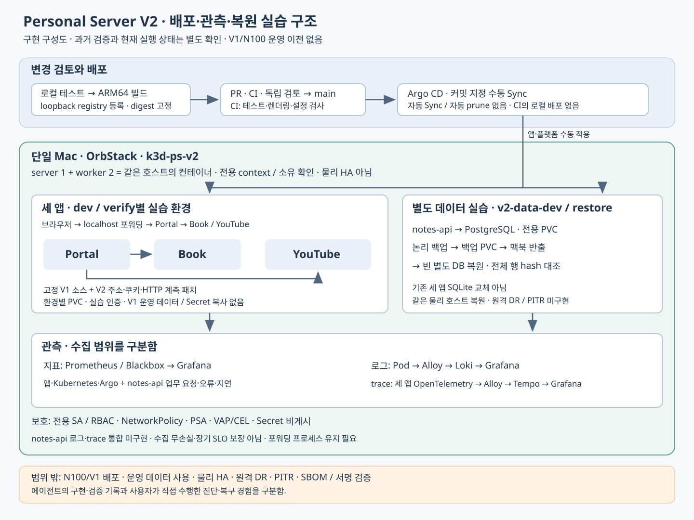

# Personal Server V2 프로젝트 설명

[쉽게 읽는 개념·예상 질문 24개](20261103_V2_쉬운개념과_면접문답.md) · [V1·V2 학습 기준자료](https://github.com/Len-Yoon/personal-server/blob/main/docs/20261103_V1V2_학습기준자료.md)

## 1. 문서 정보

| 항목 | 내용 | 비고 |
|---|---|---|
| 작성일 | 2026-11-03 | Asia/Seoul |
| 목적 | 면접에서 설계 선택·구현 범위·검증 근거와 한계를 설명함 | 실제 수행 주체와 현재 가동 상태 구분 |
| 기준 | main `7841680`, 기능 `a274143`, 코드·명세·단계별 검증 문서 | 새 실행 결과는 별도 표시 |
| 환경 | 맥북 ARM64 / OrbStack / k3d-ps-v2 | N100 운영 서버·데이터 제외 |

## 2. 핵심 요약

> V1에서 운영하던 세 앱을 맥북의 별도 Kubernetes 실습 환경에 재구성했습니다. 운영 서버에 바로 새 도구를 적용하지 않고 Argo CD 수동 배포, 지표·로그·분산 추적, 권한과 통신 정책을 연결했습니다. 별도 메모 API와 PostgreSQL을 추가해 배포 전후 데이터 보존과 빈 DB 복원도 검증했습니다. 구현·자동 검증에는 에이전트를 활용했으며, 이 결과와 제가 직접 명령을 해석하고 장애를 진단한 경험은 구분하고 있습니다.



V1에도 Kubernetes·CI·지표·백업이 존재함. V2의 의미는 도구의 최초 도입이 아니라 운영과 분리한 환경에서 Git 변경·관측·정책·복원 절차를 연결하고 확인 가능한 기록을 남긴 데 있음.

## 3. 상세 내용

### 3.1. 해결하려던 문제와 선택 이유

| 과제 | 설계 선택 | 이유·대가 |
|---|---|---|
| 새 플랫폼 실습이 운영에 영향을 줄 위험 | 별도 저장소·맥북 k3d·전용 kubeconfig/context·소유 표식 확인 | N100/V1 접근과 데이터 사용을 제외함. 같은 맥북의 노드 3개는 HA가 아님 |
| 배포 변경의 추적 | Kustomize 앱·Helm 플랫폼을 Argo Application으로 관리, 커밋 지정 수동 Sync | 원하는 상태와 실제 상태를 비교하되 자동 Sync·prune를 사용하지 않음 |
| 서비스 간 실패 원인 파악 | Portal→Book/YouTube의 지표·Pod 로그·HTTP trace 연결 | 지표로 이상을 보고 로그·trace로 요청 구간을 좁힘. 모든 서비스의 완전 계측은 아님 |
| 잘못된 권한·통신·명세 | 전용 SA·RBAC, default deny 기반 NetworkPolicy, PSA·VAP/CEL | 허용/거부를 검사함. 클러스터 관리자·호스트 권한까지 차단하는 경계는 아님 |
| 복구 가능성 확인 | 별도 notes-api·PostgreSQL·논리 백업·빈 DB 복원 | 기존 세 앱 SQLite를 이전하지 않고 실습 데이터를 대상으로 검증함 |

### 3.2. 요청과 데이터 흐름

브라우저 요청은 localhost 포워딩을 통해 dev 또는 verify의 Portal로 들어감. Portal은 같은 환경의 Book·YouTube 검색 API를 호출함. 환경별 PVC·인증·쿠키·통신을 구분함. V1 고정 커밋의 소스에 V2 주소·쿠키·계측 패치를 적용해 ARM64 이미지를 만들며 원본 V1 앱을 수정하지 않음.

| 흐름 | 경로 | 검증 범위·한계 |
|---|---|---|
| 세 앱 요청 | Portal → Book / YouTube | 부모·자식 span, 같은 요청 로그의 trace ID 연결 |
| 지표 | Prometheus·Blackbox → Grafana | Kubernetes·Argo·앱 가용성, notes-api 업무 요청·4xx·5xx·지연 |
| 로그 | 대상 앱 Pod stdout/stderr → Alloy → Loki → Grafana | 전송 전 마스킹, 호스트 전체·보안 이벤트 파일 수집 제외 |
| trace | 세 앱 OpenTelemetry → Alloy OTLP → Tempo → Grafana | notes-api 로그·trace 통합 미구현 |
| 별도 데이터 | notes-api → PostgreSQL PVC → 논리 백업 PVC → 맥북 반출 → 빈 별도 DB | 원본·복원 데이터 대조, 같은 물리 호스트의 실습 |

### 3.3. 변경을 전달하는 과정

```text
코드 → 로컬 전체 테스트 → 변경 이미지 ARM64 빌드
     → loopback registry 등록·실제 digest/아키텍처 검증
     → dev/restore·정책·lock 갱신 → PR·CI·독립 검토 → main
     → 정확한 커밋으로 Argo 수동 Sync → localhost·데이터 보존 확인
```

`tools/prepare_data_release.py`는 테스트·변경 이미지 빌드·등록·명세 갱신을 묶음. Git commit·push·PR·병합·배포를 자동 실행하지 않음. GitHub CI는 테스트·렌더링·설정을 검증하며 맥북 localhost registry에 접근하거나 로컬 클러스터에 배포하지 않음. registry 호스트 포트는 loopback으로 제한하고 배포 이미지는 digest로 고정함. digest 고정은 SBOM·서명 검증의 대체가 아님.

되돌리기는 코드·이미지 lock·허용 정책·dev/restore 명세를 함께 되돌린 검토 커밋을 적용하는 경로로 설명함. 구현된 장애 회귀·live snapshot 복구와 사용자가 직접 수행하는 Git revert 실습 완료를 구분함. PVC 삭제나 DB 복원을 일반 앱 rollback으로 실행하지 않음.

### 3.4. 면접 예상 질문과 답변

**Q. GitOps를 쓰면서 왜 자동 Sync를 켜지 않았나요?**

> 장애 실습 중 의도적으로 바꾼 상태가 자동으로 원복되는 것을 피하고, 적용할 커밋과 변경 범위를 확인한 뒤 배포하기 위해 수동 Sync를 선택했습니다. 자동 prune와 cascade finalizer도 사용하지 않아 Application 삭제가 샘플 PVC 삭제로 이어지지 않도록 했습니다. 자동화 수준보다 실습의 관찰 가능성과 데이터 보존 경계를 우선한 선택입니다.

**Q. GitOps와 CI는 어떤 역할로 나눴나요?**

> CI는 테스트·차트 렌더링·설정을 검사합니다. 이미지 빌드와 로컬 registry 등록·digest 확인은 맥북의 배포 준비 도구가 수행하고, 검토·병합한 Git 커밋을 Argo CD가 수동 Sync로 클러스터에 반영합니다. CI 성공, Git 병합, 실제 rollout 성공을 각각 확인했습니다. GitHub 실행기가 맥북 클러스터에 자동 배포하는 구조는 아닙니다.

**Q. drift와 실패 배포·Git revert를 실제로 확인했나요?**

> 에이전트 실행 기록에서 verify의 replicas를 0으로 바꾸고 Argo OutOfSync를 관찰한 뒤 같은 커밋으로 재동기화해 replicas 1과 rollout을 확인했습니다. 별도 실습 브랜치에서는 잘못된 이미지 커밋을 적용해 ImagePullBackOff와 배포 도구의 실패 종료를 확인하고, 실제 Git revert 커밋을 Sync해 복구했습니다. 두 환경의 샘플 도서도 보존됐습니다. Argo의 명세 적용 성공만으로 앱이 정상이라고 판단하지 않은 점이 핵심입니다. 이 실행 증거와 제가 직접 장애를 진단한 경험은 구분합니다.

**Q. Argo CD 자체가 멈추면 어떻게 하나요?**

> 정상 변경은 Git revert와 Sync를 사용하지만, Argo가 동작하지 않으면 같은 검토 커밋의 고정 chart·values로 최소 복구하는 비상 경로가 있습니다. 기존 클러스터에서 controller 0 상태를 만든 뒤 controller 1 Ready와 인증 hash 보존을 확인한 기록이 있습니다. 소유·context·렌더 대상을 검사하지만 서버 측 적용 충돌을 강제로 인수하는 경로이므로 정상 배포 수단으로 사용하지 않습니다. 빈 환경 전체 재설치까지 검증한 결과로 확대하지 않습니다.

**Q. 노드가 세 개면 HA인가요?**

> 아닙니다. server 1개와 worker 2개는 모두 같은 맥북의 컨테이너입니다. worker 장애의 상태 변화와 복구는 확인했지만 맥북·Docker·로컬 볼륨 장애는 공통으로 영향을 받습니다. 로컬 PVC의 타 노드 이동, 물리 HA, 다른 호스트의 재해복구를 검증한 구조는 아닙니다.

**Q. 앱 rollback과 DB 복원은 어떻게 구분하나요?**

> 앱 rollback은 코드·이미지 lock·허용 정책·dev/restore 명세를 함께 되돌린 Git 커밋을 적용하는 과정입니다. 일반 앱 rollback에 PVC 삭제나 DB 복원을 포함하지 않습니다. DB 복원은 별도 백업을 빈 DB에 넣고 전체 행 hash와 API 동작을 확인하는 실습으로 분리했습니다. 11.471초는 빈 DB가 준비된 뒤의 작은 데이터 복원 시간이며 환경 전체 RTO나 PITR을 뜻하지 않습니다. 스키마 변경의 호환성까지 일반적으로 해결한 것으로 주장하지 않습니다.

**Q. 보안 계층과 digest 고정의 의미는 무엇인가요?**

> 전용 context와 소유 확인으로 작업 대상을 제한하고, SA·RBAC으로 API 권한, NetworkPolicy로 통신, PSA·VAP/CEL로 배포 설정을 제한했습니다. Secret 값은 Git·로그에서 제외하고 앱·진단·관리자 경계를 구분했습니다. 이 계층들이 클러스터 관리자나 호스트 권한까지 제거하지는 않습니다. 이미지 digest 고정과 실제 manifest 대조는 배포할 내용의 일치를 확인하지만, 누가 만든 이미지인지 인증하는 서명 검증이나 구성요소·취약점을 다루는 SBOM을 대신하지 않습니다.

## 4. 검토 결과

다음은 원본 문서에 남은 과거 실행 결과임. 이번 문서 작업으로 재실행한 결과가 아님.

| 증거 | 확인된 결과 | 해석·비고 |
|---|---|---|
| [관측·배포 준비 검증](20261026_V2_관측배포_고도화검증.md) | 회귀 143 PASS·skip 0, Argo 18 Synced/Healthy, 27개 관측 대상 UP, 메모 API 8패널 | 2026-10-26 기능 `a274143` 기준, 서비스 27개라는 뜻 아님 |
| [초기 GitOps 실행](20261021_V2_검증기록.md) | verify replicas 0 → OutOfSync → 같은 SHA Sync → replicas 1·rollout PASS | 에이전트 실제 drift·수동 원복 검증, 사용자 직접 수행과 구분 |
| 같은 기록의 실패 배포·Git revert | `5ad3142` 적용 후 ImagePullBackOff·도구 exit 1 → 실제 revert `14b1578` Sync·rollout·양 환경 샘플 1권 보존 | 실패 실습 브랜치는 main 병합 제외, 명세 적용 성공과 앱 rollout 실패 구분 |
| [GitOps 플랫폼 전환](20261021_V2_GitOps전환_지표관측_검증기록.md) | root/self/Book/관측 7개 Sync·rollout, 기존 UID·Secret hash·샘플 보존 | 해당 초기 단계 기록, 최근 18개 상태와 합산하지 않음 |
| 같은 기록의 Argo 비상 복구 | controller 0 → 같은 명세 복구 → controller 1 Ready·인증 hash 동일 | 기존 클러스터 실제 실행, fresh bootstrap은 렌더만 검증 |
| [관측·배포 준비 검증](20261026_V2_관측배포_고도화검증.md)의 안정화 관측 | 182.795초·12표본·5xx 0, 데이터·자원 보존 | 소량 읽기 요청의 짧은 로컬 관측, SLA·부하 용량 증거 아님 |
| [보안 검증](20261022_V2_보안강화_검증기록.md) | admission 정상 6·금지 50, 실제 API 권한 30건 등 | 해당 정책·실습 범위의 허용/거부 검증 |
| [DB 복원](20261022_V2_데이터백업복구_검증기록.md) | 백업 4행과 복원 4행 hash 일치, 복원 API DML·재복원 거부 | 작은 합성 데이터, 기존 세 앱 복원 아님 |
| 같은 복원의 소요 시간 | 빈 DB 준비 후 Job 시작~API 일치 11.471초 | 환경 설치 제외, 보장 RTO/RPO·전체 DR 아님 |
| 2026-11-03 읽기 전용 현황 | Docker 실행, V2 컨테이너 5개 exited, Kubernetes API 연결 거부 | 현재 서비스 정상으로 표시하지 않음. 이번 작업에서 시작·배포하지 않음 |

## 5. 확인 필요 사항

| 항목 | 현재 한계 | 비고 |
|---|---|---|
| 수행 주체 | 에이전트 구현·테스트·독립 검토·배포 기록과 사용자 직접 수행을 구분함 | 일부 명령 안내·조회 이력만으로 전체 직접 실습 완료를 판정하지 않음 |
| 현재 가동 | 중지된 로컬 컨테이너의 재기동·서비스 health는 확인 필요 | 과거 18개/27개 정상 기록 재사용 금지 |
| 복구·가용성 | 단일 Mac·로컬 볼륨, 물리 HA·원격 DR·PITR 미구현 | 논리 백업과 동일 호스트 복원 한계 |
| 공급망·외부 의존 | SBOM·서명 검증 미구현, 폐쇄망 보류 | Book 외부 검색·YouTube 브라우저 재생 등 외부 연결 조건 존재 |
| 운영 실적 | V2는 로컬 실습 플랫폼 | N100 배포·외부 사용자 서비스·장기 SLO 달성으로 확대하지 않음 |

## 6. 후속 조치

1. [직접 학습 계획](20261026_V2_고도화학습계획.md)의 첫 미완료 과제부터 진행함. 전용 환경과 현황을 다시 확인한 뒤 정상 요청의 Pod·Service·Endpoint·PVC·로그·trace를 직접 설명함.
2. 격리 장애의 이벤트·로그·지표를 해석하고 복구 전후 증거를 남김. 이어 실패 배포·Git revert·수동 Sync와 빈 DB 복원을 직접 수행함.
3. 면접에서는 맡은 판단과 직접 실행 결과를 구체적으로 설명하며, 에이전트가 수행한 결과를 개인의 숙련 완료나 장기 운영 실적으로 표현하지 않음.

## 7. 기준 자료

[이미지 잠금](../apps/images.lock.json) · [로컬 실행 경계](../tools/lab.py) · [배포 준비](../tools/prepare_data_release.py) · [CI](../.github/workflows/validate.yml) · [서비스 통합](20261021_V2_서비스통합_검증기록.md) · [요청 추적](20261022_V2_요청추적_검증기록.md) · [V1 대비 구축 정리](20261022_V1대비_V2_구축정리.md)
